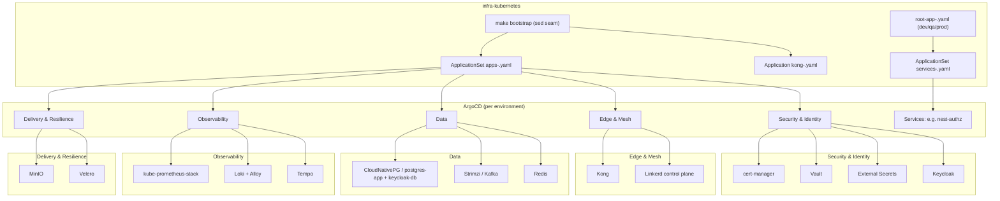
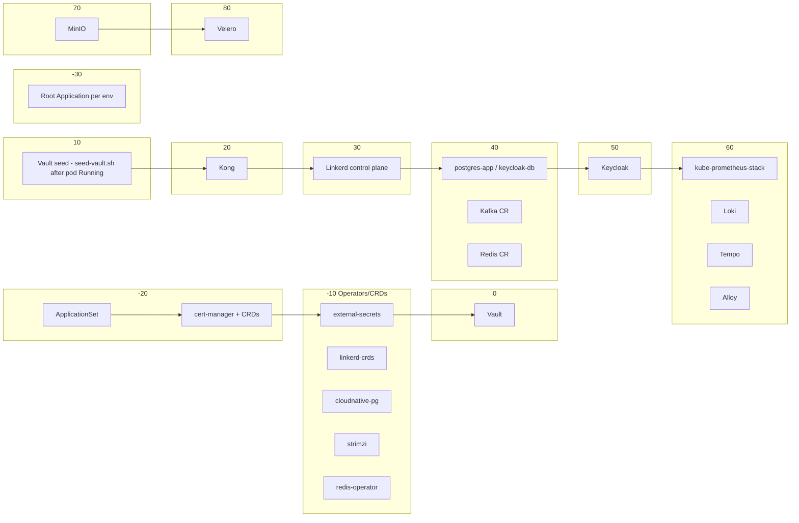
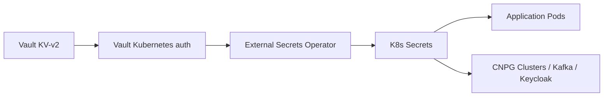

# Platform Architecture

Reference for the `sca` platform on Kubernetes: layers, the component catalog,
sync-waves, namespaces, the secret flow and the environment model. This is a
**state document** — how the platform *is*. Beyond ArgoCD, cert-manager
(Phase 1), Vault (Phase 2), external-secrets (Phase 3), linkerd-crds (Phase 4),
cloudnative-pg (Phase 5), strimzi (Phase 6), redis-operator (Phase 7), Kong
(Phase 8), the Linkerd control plane (Phase 9) and postgres-app/keycloak-db
(Phase 10) are deployed; every other catalog entry is marked `planned` until
its phase lands. For how changes *flow* through the platform, see
[workflow.md](workflow.md); for
what is done and what is next, see [status.md](status.md).

## Overview

`infra-kubernetes` is the single source of truth **for the platform catalog**.
ArgoCD (in each environment cluster) reconciles this repository via an
app-of-apps pattern per environment driven by `make bootstrap` (the `sed` seam
resolves the `{{GIT_REPO_URL}}`/`{{GIT_TARGET_BRANCH}}` placeholders host-side):

- `argocd/apps-<env>.yaml` — the **platform catalog** `ApplicationSet`: upstream
  charts/CRs for the components below (from a list generator). Seeded by `make
  bootstrap` with the ref under test (the PR head in CI, `main` otherwise).
- `argocd/kong-<env>.yaml` — the **dedicated Kong `Application`** (flat-schema
  CRDs, no SSA), seeded the same way.
- `argocd/root-app-<env>.yaml` — the root `Application` (present for
  `dev`/`qa`/`prod`; `local` has none) that owns the **services registry**.
- `argocd/services-<env>.yaml` — the **services registry** (app-repo-as-source):
  each service owns its `deploy/` in its own repository; dev/qa ArgoCD track
  `main` of the service repo and are synced by the service's `promote`
  workflow to the selected commit, while prod tracks the **version tag pinned**
  in the registry element (bumped by a reviewed `chore(services)` PR). See
  [workflow.md](workflow.md#services-app-repo-as-source) and
  [onboarding-new-service.md](onboarding-new-service.md).

There is **no global `ServerSideApply`**; Kong and `postgres-app` are dedicated
per-environment `Application`s (see [Sync-wave map](#sync-wave-map) and the
[Deviations log](#deviations-log)).
Nothing is deployed by hand after `make bootstrap`.

## Layers

Every box above is either an upstream Helm chart, a set of raw manifests, or
both. This repository builds no images.

## Component catalog

The catalog has **17 components**. Each row shows its intended namespace,
upstream chart, ArgoCD sync-wave and roadmap phase. Chart and image pins are
set per component when that phase lands (values live under
`infrastructure/<component>/` and `envs/<env>/` from Phase 1 on); in the table
ArgoCD, cert-manager (Phase 1), Vault (Phase 2), external-secrets (Phase 3),
linkerd-crds (Phase 4), cloudnative-pg (Phase 5), strimzi (Phase 6),
redis-operator (Phase 7), Kong (Phase 8), the Linkerd control plane (Phase 9)
and postgres-app/keycloak-db (Phase 10) are deployed, the rest are `planned`.

**Services are not part of this catalog.** They are registered in
`argocd/services-<env>.yaml` (app-repo-as-source) and own their manifests in
their own repositories — see
[onboarding-new-service.md](onboarding-new-service.md).

| Component | Namespace | Upstream chart | Wave | Phase | Status |
| --- | --- | --- | --- | --- | --- |
| cert-manager | `cert-manager` | jetstack/cert-manager | -20 | 1 | deployed (Phase 1) |
| vault | `vault` | hashicorp/vault | 0 | 2 | deployed (Phase 2) |
| external-secrets | `external-secrets` | external-secrets/external-secrets | -10 | 3 | deployed (Phase 3) |
| linkerd-crds | `linkerd` | linkerd/linkerd-crds | -10 | 4 | deployed (Phase 4) |
| cloudnative-pg | `cloudnative-pg` | cloudnative-pg/cloudnative-pg | -10 | 5 | deployed (Phase 5) |
| strimzi | `strimzi` | strimzi/strimzi-kafka-operator | -10 | 6 | deployed (Phase 6) |
| redis-operator | `data` | ot-container-kit/redis-operator | -10 | 7 | deployed (Phase 7) |
| kong | `kong` | kong/kong (DB-less) | 20 | 8 | deployed (Phase 8) |
| linkerd control plane | `linkerd` | linkerd/linkerd-control-plane | 30 | 9 | deployed (Phase 9) |
| postgres-app (+ keycloak-db) | `data` | CNPG `Cluster` CRs (raw) | 40 | 10 | deployed (Phase 10) |
| kafka (CR) | `data` | `Kafka` + `KafkaNodePool` CRs | 40 | 11 | planned (Phase 11) |
| redis (CR) | `data` | `Redis` CR | 40 | 12 | planned (Phase 12) |
| keycloak | `keycloak` | bitnami/keycloak | 50 | 13 | planned (Phase 13) |
| kube-prometheus-stack | `observability` | prometheus-community/kube-prometheus-stack | 60 | 14 | planned (Phase 14) |
| loki | `loki` | grafana/loki | 60 | 15 | planned (Phase 15) |
| alloy | `observability` | grafana/alloy | 60 | 15 | planned (Phase 15) |
| tempo | `tempo` | grafana/tempo | 60 | 16 | planned (Phase 16) |
| minio | `minio` | minio/minio | 70 | 17 | planned (Phase 17) |
| velero | `velero` | vmware-tanzu/velero | 80 | 18 | planned (Phase 18) |
| argocd | `argocd` | argoproj/argo-cd (Makefile bootstrap) | -30 | 0.0 | deployed — root app OutOfSync until the repo is live |

Notes:

- **Status column** is the source of truth for "is it live?". ArgoCD,
  cert-manager (Phase 1), Vault (Phase 2), external-secrets (Phase 3),
  linkerd-crds (Phase 4), cloudnative-pg (Phase 5), strimzi (Phase 6),
  redis-operator (Phase 7), Kong (Phase 8), the Linkerd control plane
  (Phase 9) and postgres-app/keycloak-db (Phase 10) are deployed; every other
  component is `planned (Phase N)`. The column is flipped to `deployed` inside the phase
  that lands the component, and `status.md` is updated in the same commit.
- `postgres-app` is a **dedicated raw `Application` per environment** (not in
  the `ApplicationSet` generator list) and owns both CNPG `Cluster`s in `data`:
  `postgres-app` (application database, `app`/`app`) and `keycloak-db`
  (`keycloak`/`keycloak`, consumed by Keycloak in Phase 13). Both run in every
  environment at wave 40. The Kafka and Redis **operators** (waves -10) are
  installed everywhere; their **custom resources** live in `data` at wave 40.
  redis-operator shares the `data` namespace with the CRs it reconciles, while
  Strimzi and CloudNativePG each get a namespace of their own (see
  [Deviations log](#deviations-log)).
- `kong` is a dedicated `Application` per environment (not via the
  `ApplicationSet`): flat-schema CRDs break ArgoCD's structured-merge diff
  under `ServerSideApply=true`, so it runs DB-less with `installCRDs: false`
  and no SSA. Routing is declarative in git — a committed `Ingress`
  (`ingressClassName: kong`) plus the `Kong*` CRs the bundled Ingress
  Controller programs into Kong; the proxy serves TLS from a cert-manager leaf
  (`sca-ca`). See [Deviations log](#deviations-log).
- The Linkerd control plane **is** an ArgoCD app — a dedicated `Application`
  (`argocd/linkerd-<env>.yaml`, wave 30), not the `linkerd install` script. helm
  chart `linkerd/linkerd-control-plane` after cert-manager and linkerd-crds are
  up; its identity PKI is provided in-cluster (cert-manager owns the issuer).
  See [Deviations log](#deviations-log).
- `local` is the only environment running the full catalog including the
  observability stack, MinIO and Velero. See [Environment model](#environment-model).
- **Not a component:** the local cloud emulator (Floci, `bootstrap/cloud-emulator.sh`)
  used by the cluster smoke is dev/CI tooling — no sync-wave, no catalog row, a
  scratch `cloud` namespace that exists only during a smoke run. Floci also backs
  the **EKS substrate** (`bootstrap/eks-emulator.sh`) that *is* the local cluster
  (a real single-node k3s container + ECR): the cluster and its throwaway IAM key
  exist only for a smoke run. See [ci-cd.md](ci-cd.md).

## Sync-wave map

ArgoCD applies resources in `sync-wave` order (`argocd.argoproj.io/sync-wave`),
integers spaced ≥10 apart so dependencies are always satisfied. Wave -30 is
the root app; the ApplicationSet and cert-manager sit at -20; the operators
and CRDs at -10; then Vault and everything downstream.

Key relationships:

- **ESO (wave -10) before Vault-secret consumers**: every `ExternalSecret`
  needs the `external-secrets` operator and the `vault` `ClusterSecretStore`.
- **Vault (wave 0) before Kong/Keycloak/datastores**, and `seed-vault.sh`
  (wave 10) runs after the Vault pod is `Running` — it is CI/manual, not an
  ArgoCD hook.
- **Kong (wave 20) before everything behind the gateway.**
- **kube-prometheus-stack (wave 60) before the radar** — the `ServiceMonitor`
  and `PrometheusRule` CRDs ship with this app. The radar design is in
  [observability-radar.md](observability-radar.md).

## Secret flow

- Secrets are declared **once** in Vault at `secret/<service>/<env>` and
  projected to native Kubernetes `Secret`s by ESO. The cluster never stores
  the original secret; only the projected copy. `.secrets/` (disk only) is
  gitignored.
- ESO `refreshInterval` is short (~5 min) in `local` to avoid the
  ExternalSecret wedge that broke the previous attempt — no manual ESO
  restarts.

Full inventory and runbooks: [secrets.md](secrets.md).

## Namespace scheme

| Namespace | Purpose |
| --- | --- |
| `argocd` | ArgoCD control plane, root Applications, ApplicationSets |
| `cert-manager` | TLS certificate management |
| `vault` | Secrets SSOT |
| `external-secrets` | Secret projection from Vault |
| `linkerd` | Service mesh CRDs and control plane |
| `cloudnative-pg` | PostgreSQL operator |
| `strimzi` | Kafka operator |
| `kong` | API gateway |
| `data` | Datastores: postgres-app, keycloak-db, Kafka, Redis — plus the redis-operator (Phase 7) |
| `keycloak` | OIDC identity provider |
| `observability` | Metrics + Grafana + Alertmanager, Alloy log collection |
| `loki` | Log aggregation (named after the chart, unlike the observability ns) |
| `tempo` | Distributed tracing |
| `minio` | S3-compatible object storage (local only) |
| `velero` | Cluster backup/restore |

## Environment model

| Environment | Profile | Sync policy | Purpose |
| --- | --- | --- | --- |
| `local` | 1 replica, full platform catalog, minimal resources | auto-sync + prune | Developer machine (Floci emulated EKS); **platform-only, no services** |
| `dev` | reduced HA | auto-sync + prune (platform); services synced on demand by the `promote` workflow | Shared integration; services via the `promote` workflow → `<service>-dev` app sync |
| `qa` | HA (3 replicas, PDBs, anti-affinity) | auto-sync, **no prune** (platform); services synced by the `promote` workflow against the `qa` approval gate | Pre-production validation; services via the `promote` workflow → `<service>-qa` app sync |
| `prod` | full HA, real storage | **manual sync** | Production |

Sync policies follow ADR-003. Platform-component promotion between environments
is gated by the `promote-test`; services promote by syncing the ArgoCD
Application of the service repo (see
[workflow.md](workflow.md#services-app-repo-as-source)).

Per-component replica profile (intended values; materialized as each phase
lands — through postgres-app, Phase 10):

| Component | local | dev | qa | prod |
| --- | --- | --- | --- | --- |
| cert-manager | 1 | 2 | 3 | 3 |
| vault (HA raft) | 1 | 1 | 3 | 3 |
| external-secrets | 1 | 2 | 3 | 3 |
| cloudnative-pg | 1 | 1 | 2 | 2 |
| strimzi | 1 | 1 | 2 | 2 |
| redis-operator | 1 | 1 | 2 | 2 |
| redis | 1 | 1 | 2 | 3 |
| kong (gateway + controller, one Deployment) | 1 | 1 | 2 | 2 |
| keycloak | 1 | 2 | 3 | 3 |
| postgres-app | 1 | 1 | 3 | 3 |
| keycloak-db | 1 | 1 | 3 | 3 |

- Vault `server.dataStorage.size`: `1Gi` default, `10Gi` (qa), `20Gi` (prod).
- Keycloak uses `podAntiAffinityPreset: hard` in `qa` and `prod`.
- `local` is the only environment that deploys the observability stack, MinIO
  and Velero, because it also plays the role of the demo/CI substrate.

## Deviations log

Repository-specific decisions, each with the reason. Appended by later phases
as each component lands; the log always explains *why*, never just *what*.

| Component | Deviation | Reason |
| --- | --- | --- |
| Makefile owns the catalog wiring; the root app owns the services registry | `make bootstrap` seeds `argocd/apps-<env>.yaml` (platform `ApplicationSet`) and `argocd/kong-<env>.yaml` (dedicated Kong `Application`) directly, with `{{GIT_REPO_URL}}`/`{{GIT_TARGET_BRANCH}}` resolved host-side (the PR head in CI). The root `Application` (`argocd/root-app-<env>.yaml`, present for `dev`/`qa`/`prod`; absent for `local`, which runs no services) owns **only** `argocd/services-<env>.yaml` — it never includes `apps-<env>`/`kong-<env>` | A single owner per object: the root app renders the catalog `ApplicationSet`/Kong app from its tracked source, but the CI smoke needs the generated children to track the **PR head**, which only a host-side seed can inject (and the runner cannot reach the EKS node's pod network to serve resolved content). Scoping the root app to the services registry removes the two-owner fight (the earlier `kong-local did not become Synced` came from the root app rendering the raw repo, where the unquoted `{{GIT_TARGET_BRANCH}}` parsed as a flow mapping) and keeps the Makefile the single seeder of the ref-under-test wiring |
| local git serve (dev tooling) | `make local-git-up` stands up an in-cluster git daemon serving this repo's HEAD **verbatim** (`bootstrap/render-served-apps.sh` mirrors `HEAD` onto the serve branch — no placeholder substitution); local ArgoCD reconciles the served tree instead of GitHub. The CI cluster smoke does **not** use it — `make bootstrap` seeds the wiring host-side | The serving/reconciliation path is exercised on a developer machine; nothing on the serve needs substitution now that `make bootstrap` owns the wiring, so the serve mirrors the repo as-is. The CI runner cannot reach the EKS node's pod network (the emulator publishes only its own port), so the smoke seeds host-side rather than serving resolved content |
| Kong | DB-less (`database: off`), `ingressController.installCRDs: false`, managed as a dedicated `Application`, no SSA | Kong ships flat-schema CRDs; structured-merge diff breaks under `ServerSideApply=true`, and `--include-crds` re-emits CRDs twice |
| postgres-app | Dedicated raw `Application` per environment (`postgres-app-<env>`), not in the `ApplicationSet` generator list; one shared manifest directory with `directory.include: "*-<env>.yaml"` | The datastores are raw CNPG `Cluster` CRs, so the Helm-chart generator cannot render them. They run in **all four** environments (app DB + Keycloak DB), and the per-env `include` keeps a single source directory while selecting only that environment's CRs. Like Kong, the dedicated app is also what the cluster smoke discovers as `postgres-app-<env>` |
| Linkerd | Control plane deployed as a **dedicated ArgoCD `Application`** (`argocd/linkerd-<env>.yaml`), **not** by the `linkerd install` script, and with **no `linkerd-viz`** | The script model cannot be validated by the cluster smoke, which discovers the catalog from `infrastructure/*/` and requires every entry to be an ArgoCD `Application` `<name>-<env>` that converges (`bootstrap/smoke-ci.sh`); the dedicated-Application pattern (same shape as Kong) makes the control plane a normal, reviewable, `git`-driven catalog entry. `linkerd-viz` stays out (headless mesh): the golden signals are scraped by the Phase 14 observability stack |
| Linkerd | The identity PKI (trust anchor + issuer) is provided **in-cluster** — `identity.externalCA=true` + `identity.issuer.scheme=kubernetes.io/tls` — with cert-manager issuing the issuer `Certificate` and the mesh's public root CA committed as a `Secret` (`linkerd-identity-anchor`, used by a `type: CA` `Issuer`) plus the public cert in the `linkerd-identity-trust-roots` `ConfigMap` | The linkerd-control-plane Helm chart does **not** generate the identity PKI (only the `linkerd install` CLI does): it takes it by `--set-file`, which ArgoCD cannot do without committing certs, or references pre-existing resources. cert-manager can own the issuer `Secret` declaratively but cannot write a `ConfigMap`, so the trust anchor cannot be projected without an extra component (trust-manager/ESO) that is not in the catalog. The anchor is a self-signed mesh root with no external trust relationship, so committing its key (used only by cert-manager to sign the issuer) is the accepted trade — the issuer's private key never enters `git`. The chart-generated webhook certs (`genSelfSignedCert`, random per render) are handled with `ignoreDifferences` on their Secrets + webhook `caBundle`s, like Kong's admission webhook. A path-scoped allowlist in `.gitleaks.toml` exempts exactly that one file from the `private-key` rule so the Security gate stays green (everything else still fails on any leak) |
| ESO | Short `refreshInterval` (~5 min) in local | Avoids the ExternalSecret wedge that wedged the previous attempt; restarts only ever manual after bootstrap |
| Vault | `local` runs the **full HA raft trio** (`server.ha.replicas: 3`) rather than the "1 replica local" profile the pre-Phase-2 docs implied; each env overlay now declares `server.ha.replicas` explicitly (local/qa/prod = 3, dev = 1), and `replicaCount` (a no-op for raft HA) is dropped | The user keeps HA in local on purpose: the raft quorum + standby→leader redirect (`vault-active`) must be exercised on the same path the smoke and qa/prod exercise, so `make smoke COMPONENT=vault` validates real HA, not a single-node special case; dev stays single-node to keep the shared integration light |
| Vault | The jetstack `hashicorp/vault` chart defaults to `global.tlsDisable: true`, which injects plain-http probe addresses that break against the TLS listener; we set `global.tlsDisable: false` and add `retry_join` with `leader_ca_cert_file` in the raft storage block | The chart ships no `retry_join` and no HTTPS probe wiring; without these the readiness probe (`vault status`) spoke HTTP to an HTTPS listener and the raft peers failed to join (`certificate signed by unknown authority` until the CA file was passed) |
| AppSet (CRD apps) | CRD `ignoreDifferences` extended with `.spec.conversion`, `.spec.names.listKind` and `.spec.preserveUnknownFields` (on top of `.spec.versions[].schema` and `.status`) | The API server defaults these fields on served CRDs even when the chart does not declare them, so without the ignore every CRD-shipping app shows a perpetual, non-convergent `OutOfSync`. The fields are server-derived, not genuine drift — the applied CRD content is still the git-pinned chart |
| linkerd-crds (local) | Five leftover Linkerd CRDs from the pre-restart bulk install (2026-09-02) removed manually: the conflicting `servers`/`serviceprofiles` and the orphaned `egressnetworks`, `externalworkloads`, `httplocalratelimitpolicies` (managed by no app) | SSA cannot remove extra CRD versions or objects it does not manage, so the newer-version leftovers made the app converge to a permanent `OutOfSync`. After cleanup the chart 1.8.0 app re-applied pristine definitions and re-converged to `Synced`. One-off cluster hygiene, not repo state |
| cloudnative-pg + future-phase CRDs (local) | Same one-off cluster hygiene extended: **60 orphaned CRDs** from the 2026-09-02 bulk install removed — the 11 `postgresql.cnpg.io` (Phase 5) plus the undeployed groups `kafka.strimzi.io`/`core.strimzi.io` (10, Phase 6), `redis.redis.opstreelabs.in` (4, Phase 7), `configuration.konghq.com` (12, Phase 8), `monitoring.coreos.com`/`monitoring.grafana.com` (11, Phase 14) and `velero.io` (13, Phase 18). All lacked ArgoCD ownership (`helm.sh/resource-policy: keep`, no tracking labels) | Extra CRDs not owned by any app wedge the app that ships them into a permanent `OutOfSync` under SSA (same as the linkerd-crds row); each future phase would have hit the same gate. The converging `cloudnative-pg` app re-created its 11 CRDs as app-owned and converged `Synced`+`Healthy`; the undeployed groups were plain leftovers. ArgoCD, cert-manager, external-secrets and linkerd CRDs untouched |
| redis-operator | The operator is installed in the **`data` namespace**, sharing it with the datastores it reconciles, instead of getting a namespace of its own like `strimzi` / `cloudnative-pg` | `data` is where the Phase 10/11/12 CRs land; the operator watches every namespace anyway (`watchNamespace: ""` renders no `WATCH_NAMESPACE`, RBAC is cluster-scoped), so a dedicated namespace would only add a second place to look. It also means the wave -10 app is the first thing to create `data` (`CreateNamespace=true`) |
| redis-operator | **No PodDisruptionBudget** in the `qa`/`prod` overlays (both run 2 replicas with soft anti-affinity), and the chart's **webhook stays off** | This chart ships no PDB value, so a budget would have to be a raw manifest under `infrastructure/redis-operator/manifests/` — and that directory is env-agnostic, so it would also apply to `local`. The operator is stateless and leader-elected, so a voluntary eviction just re-elects a leader. The webhook only gates the `masterSlaveAntiAffinity` feature (and drags a serving certificate in with it); nothing in the platform uses master/slave anti-affinity — Sentinel and cluster topologies arrive as their own CRs at Phase 12 — so it stays off |
| redis-operator | `chartRepo` is pinned to `https://ot-container-kit.github.io/helm-charts` instead of the documented `https://charts.ot-container-kit.io` | The old host stopped resolving upstream: it answers `NXDOMAIN` authoritatively for `io` (verified against public DNS on 2026-09-27), which wedged the app in `ComparisonError: failed to fetch chart`. The maintainers publish the same charts from the GitHub Pages repo of `ot-container-kit/helm-charts` — same publisher, same chart versions, `redis-operator` 0.26.1 with an identical digest — so the pin stays official and version-pinned, and ArgoCD reaches it as any other `https://` chart repo. Recorded in `docs/roadmap/redis-operator.md` |
| Releases | The tag is cut automatically when the release PR merges and the release goes out as a **full release held off `latest`**, with the pointer left on the previous release; only the manual `Release promote` workflow moves `latest` forward — so the automation never promotes a release on its own | `make_latest` is the lever: GitHub defaults it to `true` for newly published releases and release-please never sends it, so publishing a full release would claim the pointer on its own. Declining it is not enough on its own either — `make_latest=false` stores no pointer and `GET /releases/latest` falls back to the newest published release — so the local `finalize` job publishes off `latest` *and* re-designates the previous release, which keeps the pointer tied to adoption instead of to merge order, the same rule the Services row follows. A draft would keep it off too, but the shared flow's tag force-push publishes it. See [versioning.md](versioning.md) |
| Services | A service is **app-repo-as-source**: its Kubernetes manifests live in the service's own repo (`deploy/`); dev/qa ArgoCD track `main` and are synced to the selected commit by the service's `promote` workflow (ArgoCD API, scoped token), while prod tracks the **version tag pinned** in `services-prod.yaml` (`version`, bumped by a reviewed `chore(services)` PR that also carries the go/no-go). `local` intentionally does **not** run services (`services-<env>.yaml` exists only for `dev`/`qa`/`prod`) | Services iterate daily (multiple deploys a day per service) and a PR-per-deployment in `infra-kubernetes` would turn TBD into a bottleneck. Keeping services self-owned while the catalog components stay centralized (the two `ApplicationSet`s in the root app) preserves git as the deployment gate: dev/qa are ArgoCD app syncs run from the service repo, prod is a one-line version bump (`chore(services)`, so it never opens an infra release PR) plus a human `Sync` (ADR-003). Each service release cuts an immutable semver tag that is marked `latest` only once prod adopted it (the Releases row above), which is what makes prod rollback a revert of the pin. This is a documented deviation from the single-repo-catalog model, constrained to the services registry |
| Cloud emulator (dev/CI tooling) | The cluster smoke stands up a local cloud emulator (Floci) as a **Docker container on the runner**, published into the EKS-substrate cluster with a selector-less `Service` + `EndpointSlice` in a scratch `cloud` namespace — **not** as an ArgoCD Application, with no sync-wave and no catalog entry | Proving cloud integration needs an endpoint, not a cloud account: the emulator is the EKS substrate itself, so it is published via an endpoint-backed Service to give the platform a stable in-cluster DNS name without IAM, per-cloud configuration or a managed service. It is tooling for the smoke ([ci-cd.md](ci-cd.md)), so it deliberately stays out of the platform catalog |
| EKS substrate (dev/CI tooling) | The `Smoke` job runs on Floci's emulated **EKS** — the platform's only cluster substrate (a real single-node k3s container + OCI ECR registry): `bootstrap/eks-emulator.sh` mints a throwaway IAM user/key, creates the cluster, writes a `floci-eks` kube-context, and the smoke boots the **full platform** on it via the real `make bootstrap` app-of-apps — **not** as an ArgoCD Application, with no sync-wave and no catalog entry | It proves the two EKS-specific paths a plain local cluster does not — an IAM-authenticated kubeconfig to a live API server, and an image pulled in-cluster from the emulated ECR via the node's registry mirror — while running the whole catalog through the same GitOps path `dev`/`qa`/`prod` use. The cluster and IAM key are throwaway (deleted on `make eks-down`), so it stays out of the platform catalog like the endpoint emulator |

## Change flow (summary)

Full detail in [workflow.md](workflow.md): a change lands via PR, is validated
by CI (static always; selective cluster smoke of the touched component from
Phase 1 — a required PR check, profile `local` — see [ci-cd.md](ci-cd.md)),
merges to `main`, and each environment's ArgoCD applies it according to its own
sync policy (`local`/`dev` auto, `qa` auto-no-prune, `prod` manual by a human).
