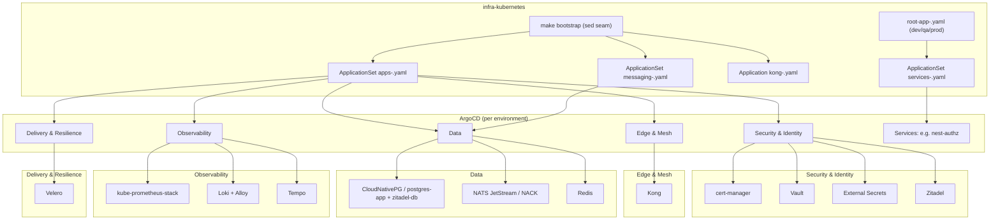
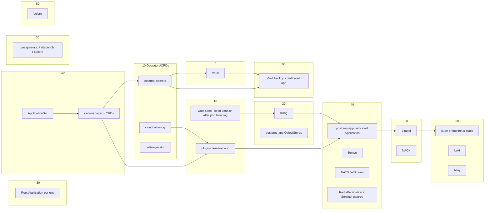
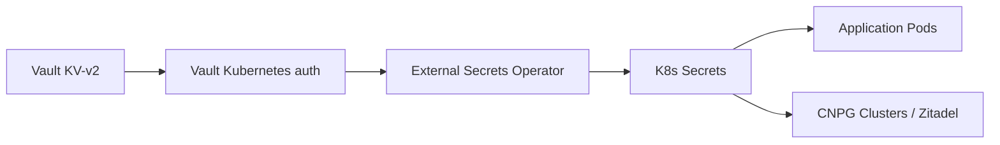

# Platform Architecture

Reference for the `sca` platform on Kubernetes: layers, the component catalog,
sync-waves, namespaces, the secret flow and the environment model. This is a
**state document** — how the platform *is*. Beyond ArgoCD, cert-manager
(Phase 1), Vault (Phase 2), external-secrets (Phase 3),
cloudnative-pg (Phase 5), redis-operator (Phase 7), Kong (Phase 8),
postgres-app/zitadel-db (Phase 10 + ADR-004), Redis (Phase 12),
Zitadel (ADR-004 E1/E2), NATS/NACK (ADR-005) and
Velero (Phase 18) are deployed;
the observability components (Phases 14-16) remain `planned`. For how changes *flow* through the platform, see
[workflow.md](workflow.md); for
what is done and what is next, see [status.md](status.md).

## Overview

`infra-kubernetes` is the single source of truth **for the platform catalog**.
ArgoCD (in each environment cluster) reconciles this repository via an
app-of-apps pattern per environment driven by `make bootstrap` (the `sed` seam
resolves the `{{GIT_REPO_URL}}`/`{{GIT_TARGET_BRANCH}}` placeholders host-side):

- `argocd/apps-<env>.yaml` — the **platform catalog** `ApplicationSet`: upstream
  charts/CRs for the components below (from a list generator). Seeded by `make
  bootstrap` with the ref under test (the PR head in CI, `main` otherwise).
- `argocd/messaging-<env>.yaml` — the **optional messaging `ApplicationSet`**
  (git files generator over `argocd/messaging/<env>/*.yaml`): the descriptor
  files toggle NATS/NACK per environment; see [messaging.md](messaging.md) for
  the procedure.
- `argocd/kong-<env>.yaml` — the **dedicated Kong `Application`** (flat-schema
  CRDs, no SSA), seeded the same way.
- `argocd/root-app-<env>.yaml` — the root `Application` (present for
  `dev`/`qa`/`prod`; `local` has none) that owns the **services registry**.
- `argocd/services-<env>.yaml` — the **services registry** (app-repo-as-source):
  each service owns its `deploy/` in its own repository; dev/qa ArgoCD track
  `main` of the service repo and are synced by the service's `promote`
  workflow to the selected commit, while prod tracks the **version tag pinned**
  in the registry element (bumped by a reviewed `chore(services)` PR). See
  [workflow.md](workflow.md#services-app-repo-as-source) and
  [onboarding-new-service.md](onboarding-new-service.md).

There is **no global `ServerSideApply`**; Kong, `postgres-app`, Redis and
Zitadel are dedicated per-environment `Application`s (see [Sync-wave map](#sync-wave-map)
and the [Deviations log](#deviations-log)).
Nothing is deployed by hand after `make bootstrap`.

## Layers

Every box above is either an upstream Helm chart, a set of raw manifests, or
both. This repository builds no images.

## Component catalog

The catalog has **17 components** plus ArgoCD. Each row shows its intended
namespace, upstream chart, ArgoCD sync-wave and roadmap phase. Chart and image
pins are set per component when that phase lands (values live under
`infrastructure/<component>/` and `envs/<env>/` from Phase 1 on); in the table
ArgoCD, cert-manager (Phase 1), Vault (Phase 2), external-secrets (Phase 3),
cloudnative-pg (Phase 5), plugin-barman-cloud (#121), redis-operator (Phase 7),
Kong (Phase 8),
postgres-app/zitadel-db (Phase 10 + ADR-004), Redis (Phase 12),
Zitadel (ADR-004 E1/E2), NACK/NATS (NATS migration C1–C4) and Velero
(Phase 18) are
deployed; the observability components (Phases 14-16) remain `planned`.

**Services are not part of this catalog.** They are registered in
`argocd/services-<env>.yaml` (app-repo-as-source) and own their manifests in
their own repositories — see
[onboarding-new-service.md](onboarding-new-service.md).

| Component | Namespace | Upstream chart | Wave | Phase | Status |
| --- | --- | --- | --- | --- | --- |
| cert-manager | `cert-manager` | jetstack/cert-manager | -20 | 1 | deployed (Phase 1) |
| vault | `vault` | hashicorp/vault | 0 | 2 | deployed (Phase 2) |
| external-secrets | `external-secrets` | external-secrets/external-secrets | -10 | 3 | deployed (Phase 3) |
| cloudnative-pg | `cloudnative-pg` | cloudnative-pg/cloudnative-pg | -10 | 5 | deployed (Phase 5) |
| plugin-barman-cloud | `cloudnative-pg` | cloudnative-pg/plugin-barman-cloud | 10 | — (#121) | deployed (#121) |
| redis-operator | `data` | ot-container-kit/redis-operator | -10 | 7 | deployed (Phase 7) |
| kong | `kong` | kong/kong (DB-less) | 20 | 8 | deployed (Phase 8) |
| postgres-app (+ zitadel-db) | `data` | CNPG `Cluster` CRs (raw) | 40 | 10 | deployed (Phase 10 + ADR-004 E1/E4) |
| nats (JetStream) | `data` | nats/nats (JetStream) | 40 | — | deployed (NATS migration C1–C4, idle; optional per env) |
| nack (JetStream controller) | `nats` | nats/nack | 50 | — | deployed (NATS migration C1–C4; optional per env) |
| redis (CR) | `data` | `RedisReplication` CR | 40 | 12 | deployed (Phase 12) |
| zitadel (+ edge) | `zitadel` | zitadel/zitadel (h2c behind Kong TLS) | 50 | — (ADR-004 E1/E2) | deployed (E1/E2 validated) |
| kube-prometheus-stack | `observability` | prometheus-community/kube-prometheus-stack | 60 | 14 | planned (Phase 14) |
| loki | `loki` | grafana/loki | 60 | 15 | planned (Phase 15) |
| alloy | `observability` | grafana/alloy | 60 | 15 | planned (Phase 15) |
| tempo | `tempo` | grafana/tempo | 60 | 16 | planned (Phase 16) |
| velero | `velero` | vmware-tanzu/velero | 80 | 18 | deployed (Phase 18); backup layer expanded and live restore-validated in Phase B (2026-11-14) |
| argocd | `argocd` | argoproj/argo-cd (Makefile bootstrap) | -30 | 0.0 | deployed — root app OutOfSync until the repo is live |

Notes:

- **Status column** is the source of truth for "is it live?". ArgoCD,
  cert-manager (Phase 1), Vault (Phase 2), external-secrets (Phase 3),
  cloudnative-pg (Phase 5), plugin-barman-cloud (#121),
  redis-operator (Phase 7), Kong (Phase 8),
  postgres-app/zitadel-db (Phase 10 + ADR-004), Redis (Phase 12),
  Zitadel (ADR-004 E1/E2), NACK/NATS (NATS migration C1–C4) and Velero (Phase 18)
  are deployed; the observability components (Phases 14-16) remain `planned (Phase N)`. The
  CNPG scheduled backups and Vault Raft snapshot CronJob are **backup
  resources**, not separate catalog components; they are described in
  [backups.md](backups.md) and tracked in `status.md`. The column is flipped
  to `deployed` inside the phase that lands the component, and `status.md` is
  updated in the same commit.
- `plugin-barman-cloud` is an `ApplicationSet` element (wave 10, namespace
  `cloudnative-pg`) installed from chart `plugin-barman-cloud` 0.9.0. It ships
  the `ObjectStore` CRD and the pinned sidecar image; the per-environment
  `ObjectStore` CRs live with the datastore manifests in `postgres-app` at
  wave 20, and the `Cluster`s reference them at wave 30.
- `postgres-app` is a **dedicated raw `Application` per environment** (not in
  the `ApplicationSet` generator list) and owns two CNPG `Cluster`s in `data`:
  `postgres-app` (application database, `app`/`app`) and `zitadel-db`
  (`zitadel`/`zitadel`, consumed by Zitadel in ADR-004 E1). Both run in every
  environment at wave 40; the former `keycloak-db` was removed in ADR-004 E4. The Redis **operator** (wave -10) is installed
  everywhere; its **custom resources** live in `data` at wave 40 — Redis is
  deployed at Phase 12. redis-operator shares the `data` namespace with the CRs
  it reconciles, while CloudNativePG gets a namespace of its own (see
  [Deviations log](#deviations-log)).
- `nats` and `nack` are **optional `ApplicationSet` elements** (not dedicated
  apps), deployed idle as the ADR-005 event backbone; Kafka/Strimzi were removed
  in C3. The
  dedicated `argocd/messaging-<env>.yaml` ApplicationSet uses a git files
  generator over `argocd/messaging/<env>/*.yaml`: the descriptors present in
  NATS mode generate `nats` (chart `nats/nats` 2.15.2, namespace `data`, wave
  40, JetStream + file-store PVC) and `nack` (chart `nats/nack` 0.35.0 /
  controller 0.24.0, namespace `nats`, wave 50). Both ship **no**
  `Stream`/`Consumer` CRs. Removing the descriptors switches that environment to
  SNS/SQS mode and removes the Applications; the per-env values overlays stay in
  git either way. The platform Applications are not children of a root app, so
  cross-Application sync-waves are best-effort — the controller retries until
  NATS answers. See [ADR-005](adr/adr-005-kafka-to-nats-jetstream.md).
- `zitadel` is a **dedicated multi-source `Application` per environment**
  (`zitadel-<env>`, wave 50): chart `zitadel/zitadel` 10.5.0, the `$values` refs,
  three per-env ExternalSecrets and the shared TLS/Ingress resources reconcile
  as one app. It uses the wave-40 `zitadel-db`; E2 terminates TLS at Kong,
  reaches the h2c Service through the gRPC upstream protocol and is verified by
  the edge discovery smoke. See [Deviations log](#deviations-log).
- `kong` is a dedicated `Application` per environment (not via the
  `ApplicationSet`): flat-schema CRDs break ArgoCD's structured-merge diff
  under `ServerSideApply=true`, so it runs DB-less with `installCRDs: false`
  and no SSA. Routing is declarative in git — a committed `Ingress`
  (`ingressClassName: kong`) plus the `Kong*` CRs the bundled Ingress
  Controller programs into Kong; the proxy serves TLS from a cert-manager leaf
  (`sca-ca`). See [Deviations log](#deviations-log).
- `local` is the only environment running the full catalog including the
  observability stack; Velero, CNPG backups, and Vault Raft snapshots are
  **configured in all four** environments (local on Floci S3, external S3
  elsewhere). See
  [Environment model](#environment-model) and [backups.md](backups.md).
- **Not a component:** the local cloud emulator (Floci, `bootstrap/cloud-emulator.sh`)
  used by the cluster smoke is dev/CI tooling — no sync-wave, no catalog row, a
  scratch `cloud` namespace that exists only during a smoke run. Floci also backs
  the **EKS substrate** (`bootstrap/eks-emulator.sh`) that *is* the local cluster
  (a real single-node k3s container + ECR): the cluster and its throwaway IAM key
  exist only for a smoke run. See [ci-cd.md](ci-cd.md).

## Sync-wave map

ArgoCD applies resources in `sync-wave` order (`argocd.argoproj.io/sync-wave`),
integers spaced ≥10 apart so dependencies are always satisfied. Wave -30 is
the root app; the ApplicationSet and cert-manager sit at -20; the operators
and CRDs at -10; then Vault, the Barman Cloud plugin and everything downstream.

Key relationships:

- **ESO (wave -10) before Vault-secret consumers**: every `ExternalSecret`
  needs the `external-secrets` operator and the `vault` `ClusterSecretStore`.
- **Vault (wave 0) before Kong/Zitadel/datastores**, and `seed-vault.sh`
  (wave 10) runs after the Vault pod is `Running` — it is CI/manual, not an
  ArgoCD hook.
- **Kong (wave 20) before everything behind the gateway.**
- **Backup resources**: the CNPG `ScheduledBackup`s and backup-credential
  `ExternalSecret`s share the datastore wave so they never introduce an
  intermediate health gate while Vault is sealed. The Vault Raft snapshot
  CronJob is its own dedicated Application, annotated wave 90 to document the
  intended order after Vault and ESO; because the Makefile applies these
  standalone Applications directly, that annotation does not order them
  across apps. The CronJob stays dormant until its schedule or the smoke
  triggers it, so ESO can finish projecting credentials in the meantime. The
  local bucket Job runs as a Velero `PreSync` hook. See
  [backups.md](backups.md).
- **kube-prometheus-stack (wave 60) before the radar** — the `ServiceMonitor`
  and `PrometheusRule` CRDs ship with this app. The radar design is in
  [observability-radar.md](observability-radar.md).

## Secret flow

- Secrets are declared **once** in Vault at `secret/<service>/<env>` and
  projected to native Kubernetes `Secret`s by ESO. The cluster never stores
  the original secret; only the projected copy. `.secrets/` (disk only) is
  gitignored.
- ESO `refreshInterval` is short (~5 min) in `local` to avoid the
  ExternalSecret wedge that broke the previous attempt — no manual ESO
  restarts.

Full inventory and runbooks: [secrets.md](secrets.md).

## Namespace scheme

| Namespace | Purpose |
| --- | --- |
| `argocd` | ArgoCD control plane, root Applications, ApplicationSets |
| `cert-manager` | TLS certificate management |
| `vault` | Secrets SSOT |
| `external-secrets` | Secret projection from Vault |
| `cloudnative-pg` | PostgreSQL operator |
| `kong` | API gateway |
| `data` | Datastores: postgres-app, zitadel-db, NATS JetStream, Redis — plus the redis-operator (Phase 7) |
| `nats` | NACK JetStream controller |
| `zitadel` | OIDC identity provider (ADR-004 E1/E2, h2c behind Kong TLS) |
| `observability` | Metrics + Grafana + Alertmanager, Alloy log collection |
| `loki` | Log aggregation (named after the chart, unlike the observability ns) |
| `tempo` | Distributed tracing |
| `velero` | Cluster backup/restore (local: Floci S3) |

## Environment model

| Environment | Profile | Sync policy | Purpose |
| --- | --- | --- | --- |
| `local` | 1 replica, full platform catalog, minimal resources | auto-sync + prune | Developer machine (Floci emulated EKS); **platform-only, no services** |
| `dev` | reduced HA | auto-sync + prune (platform); services synced on demand by the `promote` workflow | Shared integration; services via the `promote` workflow → `<service>-dev` app sync |
| `qa` | HA (3 replicas, PDBs, anti-affinity) | auto-sync, **no prune** (platform); services synced by the `promote` workflow against the `qa` approval gate | Pre-production validation; services via the `promote` workflow → `<service>-qa` app sync |
| `prod` | full HA, real storage | **manual sync** | Production |

Sync policies follow ADR-003. Platform-component promotion between environments
is gated by the `promote-test`; services promote by syncing the ArgoCD
Application of the service repo (see
[workflow.md](workflow.md#services-app-repo-as-source)).

Per-component replica profile (intended values; materialized as each phase
lands — through the NATS migration, C1):

| Component | local | dev | qa | prod |
| --- | --- | --- | --- | --- |
| cert-manager | 1 | 2 | 3 | 3 |
| vault (HA raft) | 1 | 1 | 3 | 3 |
| external-secrets | 1 | 2 | 3 | 3 |
| cloudnative-pg | 1 | 1 | 2 | 2 |
| redis-operator | 1 | 1 | 2 | 2 |
| redis | 1 | 1 | 3 | 3 |
| kong (gateway + controller, one Deployment) | 1 | 1 | 2 | 2 |
| zitadel (API + login) | 1 | 1 | 3 | 3 |
| postgres-app | 1 | 1 | 3 | 3 |
| zitadel-db | 1 | 1 | 3 | 3 |
| nats (JetStream nodes) | 1 | 1 | 3 | 3 |
| nack (controller) | 1 | 1 | 1 | 1 |

- Vault `server.dataStorage.size`: `1Gi` default, `10Gi` (qa), `20Gi` (prod).
- Zitadel uses **preferred** pod anti-affinity in qa/prod (the single-node
  promote substrate still schedules).
- `local` is the only environment that deploys the observability stack,
  because it also plays the role of the demo/CI substrate. Velero, CNPG
  backups, and Vault Raft snapshots are configured in all four environments;
  their local object store is Floci's S3 emulator (dev/CI tooling), not a
  catalog component. See [backups.md](backups.md).

## Deviations log

Repository-specific decisions, each with the reason. Appended by later phases
as each component lands; the log always explains *why*, never just *what*.

| Component | Deviation | Reason |
| --- | --- | --- |
| Makefile owns the catalog wiring; the root app owns the services registry | `make bootstrap` seeds `argocd/apps-<env>.yaml` (platform `ApplicationSet`), `argocd/messaging-<env>.yaml` (optional NATS/NACK `ApplicationSet`) and `argocd/kong-<env>.yaml` (dedicated Kong `Application`) directly, with `{{GIT_REPO_URL}}`/`{{GIT_TARGET_BRANCH}}` resolved host-side (the PR head in CI). The root `Application` (`argocd/root-app-<env>.yaml`, present for `dev`/`qa`/`prod`; absent for `local`, which runs no services) owns **only** `argocd/services-<env>.yaml` — it never includes `apps-<env>`/`messaging-<env>`/`kong-<env>` | A single owner per object: the root app renders the catalog `ApplicationSet`/Kong app from its tracked source, but the CI smoke needs the generated children to track the **PR head**, which only a host-side seed can inject (and the runner cannot reach the EKS node's pod network to serve resolved content). Scoping the root app to the services registry removes the two-owner fight (the earlier `kong-local did not become Synced` came from the root app rendering the raw repo, where the unquoted `{{GIT_TARGET_BRANCH}}` parsed as a flow mapping) and keeps the Makefile the single seeder of the ref-under-test wiring |
| local git serve (dev tooling) | `make local-git-up` stands up an in-cluster git daemon serving this repo's HEAD **verbatim** (`bootstrap/render-served-apps.sh` mirrors `HEAD` onto the serve branch — no placeholder substitution); local ArgoCD reconciles the served tree instead of GitHub. The CI cluster smoke does **not** use it — `make bootstrap` seeds the wiring host-side | The serving/reconciliation path is exercised on a developer machine; nothing on the serve needs substitution now that `make bootstrap` owns the wiring, so the serve mirrors the repo as-is. The CI runner cannot reach the EKS node's pod network (the emulator publishes only its own port), so the smoke seeds host-side rather than serving resolved content |
| Kong | DB-less (`database: off`), `ingressController.installCRDs: false`, managed as a dedicated `Application`, no SSA | Kong ships flat-schema CRDs; structured-merge diff breaks under `ServerSideApply=true`, and `--include-crds` re-emits CRDs twice |
| postgres-app | Dedicated raw `Application` per environment (`postgres-app-<env>`), not in the `ApplicationSet` generator list; one shared manifest directory with `directory.include: "*-<env>.yaml"`; within the Application, namespace/RBAC/policies are wave 0, credential and role `ExternalSecret`s are wave 10, `ObjectStore`s are wave 20, `Cluster`s and `DatabaseRole`s are wave 30, and bootstrap Jobs and `ScheduledBackup`s are wave 40 | The datastores are raw CNPG `Cluster` CRs, so the Helm-chart generator cannot render them. They run in **all four** environments (app DB + Zitadel DB), and the per-env `include` keeps a single source directory while selecting only that environment's CRs. Like Kong, the dedicated app is also what the cluster smoke discovers as `postgres-app-<env>`. The internal wave split keeps credentials before the `ObjectStore` that references them, the `ObjectStore` before the `Cluster` that archives through it, `DatabaseRole`s after their password Secrets, the bootstrap Job after the roles it grants, and the `ScheduledBackup` after a healthy datastore; the CI smoke seeds Vault before waiting for the catalog to converge |
| Keycloak retirement (ADR-004 E4) | All `keycloak-<env>` Applications, chart/values/realm/TLS manifests, per-env overlays, smoke, Vault seeds/paths, `keycloak-db` clusters/credentials/backups and Makefile/CI/Velero wiring were removed; Zitadel is the only IdP | E3 closed with no OIDC clients or service deployments to migrate, so there was no coexistence or service cutover to preserve. Keeping retired runtime would leave an unused identity plane, database and secret surface; removing it in one reviewed change keeps the catalog honest and makes rollback a clean revert rather than a forward-fix chain. The CNPG latest-backup restore smoke moved to `zitadel-db` and the External Secrets smoke to `secret/postgres-app/<env>`, so the platform gates still exercise live resources |
| Zitadel (ADR-004 E1 + E2 edge) | Dedicated multi-source `Application` per environment (`zitadel-<env>`, wave 50) with chart + `$values` + per-env ExternalSecrets + shared `Certificate`/`Ingress` resources; Kong terminates TLS for `https://zitadel.local` and proxies the h2c `zitadel` Service via `konghq.com/protocol: grpc`, with a separate Ingress for `/ui/v2/login`; the DSN points at the retained CNPG `zitadel-db` cluster; `ExternalPort: 443` in every env so the issuer stays canonical | The E1 deployment kept h2c internal because a plain Kong/nginx proxy cannot proxy a generic h2c upstream (`Kong/kong#8767`, `Kong/kubernetes-ingress-controller#2473`), while Zitadel requires h2c for gRPC and the console (`zitadel.com/docs/self-hosting/manage/http2`). E2 uses Kong's gRPC upstream protocol plus route protocols `https,grpcs` to cross that boundary; the live gate passed on 2026-11-24 with discovery and login UI served over the Kong/TLS edge. The DSN mode is used because CNPG creates the database/owner at bootstrap, so the chart's default `CREATE DATABASE` init command would fail; `initJob.command: zitadel` runs only ZITADEL's own initialization. The runtime ConfigMap is de-hooked and applied at wave `-6` (before init/setup at `-5`/`-4`), so config edits converge instead of being skipped as Helm hooks. Zitadel `v4.19.2` ignores non-standard `ExternalPort` in discovery when `ExternalSecure: true` (`zitadel#11380`), so the edge stays canonical at 443. See [ADR-004](adr/adr-004-keycloak-to-zitadel.md) |
| nats + nack | Both are optional elements of a dedicated `messaging-<env>` `ApplicationSet` (not the platform list); NACK is pinned at wave 50 (after the NATS server at 40), NATS ships "ready but idle" with no `Stream`/`Consumer` CRs, and the tier has no client auth yet | NACK connects to NATS at startup; the platform Applications are not children of a root app, so cross-Application sync-waves are not enforced, and placing NACK after NATS keeps the logical order while the controller retries until the server answers. Idle avoids committing streams before the toggle and the consumers exist (ADR-005); once the first consumer lands, NATS accounts/credentials are wired through Vault/ESO. Both use upstream charts, so the ApplicationSet covers them without dedicated app files. See [messaging.md](messaging.md) for the toggle and service-owned topology |
| Messaging toggle (NATS/NACK) | A dedicated `argocd/messaging-<env>.yaml` `ApplicationSet` (git files generator over `argocd/messaging/<env>/*.yaml`) owns the optional NATS/NACK Applications; the descriptors exist in NATS mode and are removed for SNS/SQS mode. The app template sets `resources-finalizer.argocd.argoproj.io`, so removing a descriptor deletes the Application and its resources. The per-env values overlays (`envs/<env>/{nats,nack}.yaml`) remain in both modes | The platform list generator cannot express "this component is optional per environment". A git files generator is declarative and needs no values-flag conditionals: the file set in git *is* the mode. Keeping the values overlays makes switching back a descriptor-only change, while the finalizer guarantees SNS/SQS mode leaves no NATS pods behind (the idle tier has no data worth preserving). The app names stay `nats-<env>`/`nack-<env>`, so the existing smokes and catalog discovery are unchanged. Vault's `secret/messaging/<env>` is the runtime contract (`mode` + endpoints); the descriptor set is the deployment gate |
| Messaging contract | `secret/messaging/<env>` is the single KV-v2 contract: `mode` (`nats`/`sns-sqs`), `nats_url`, and the SNS/SQS coordinates (`sns_topic_arn`, `sqs_queue_url`, `aws_region`, optional endpoint/credentials). `bootstrap/seed-vault.sh` seeds local `mode=nats`; external environments provision the path out of band | Consumers must switch backends without code changes, and Vault is the secrets SSOT. A per-service copy would drift; a platform ConfigMap would not carry credentials. Keeping the contract in Vault lets every service project it with its own ESO scope. No consumer exists yet, so the idle tier remains unauthenticated |
| Linkerd removal (D4; docs closed D5) | Linkerd CRDs, control plane, identity PKI, smokes, service-template annotation and repository wiring were removed after the Calico `v3.31.7` + WireGuard D2/D3 gates | The CNI substrate now provides authenticated node-to-node transport; service-mesh golden signals and L7 features are consciously dropped (ADR-008/ADR-009). The removed committed trust anchor also eliminates the former `.gitleaks.toml` exception |
| ESO | Short `refreshInterval` (~5 min) in local | Avoids the ExternalSecret wedge that wedged the previous attempt; restarts only ever manual after bootstrap |
| Vault | `local` runs the **full HA raft trio** (`server.ha.replicas: 3`) rather than the "1 replica local" profile the pre-Phase-2 docs implied; each env overlay now declares `server.ha.replicas` explicitly (local/qa/prod = 3, dev = 1), and `replicaCount` (a no-op for raft HA) is dropped | The user keeps HA in local on purpose: the raft quorum + standby→leader redirect (`vault-active`) must be exercised on the same path the smoke and qa/prod exercise, so `make smoke COMPONENT=vault` validates real HA, not a single-node special case; dev stays single-node to keep the shared integration light |
| Vault | The jetstack `hashicorp/vault` chart defaults to `global.tlsDisable: true`, which injects plain-http probe addresses that break against the TLS listener; we set `global.tlsDisable: false` and add `retry_join` with `leader_ca_cert_file` in the raft storage block | The chart ships no `retry_join` and no HTTPS probe wiring; without these the readiness probe (`vault status`) spoke HTTP to an HTTPS listener and the raft peers failed to join (`certificate signed by unknown authority` until the CA file was passed) |
| AppSet (CRD apps) | CRD `ignoreDifferences` extended with `.spec.conversion`, `.spec.names.listKind` and `.spec.preserveUnknownFields` (on top of `.spec.versions[].schema` and `.status`) | The API server defaults these fields on served CRDs even when the chart does not declare them, so without the ignore every CRD-shipping app shows a perpetual, non-convergent `OutOfSync`. The fields are server-derived, not genuine drift — the applied CRD content is still the git-pinned chart |
| AppSet (StatefulSet apps) | StatefulSet `ignoreDifferences` extended with `.spec.volumeClaimTemplates[].apiVersion` and `.spec.volumeClaimTemplates[].kind` | The API server defaults `apiVersion`/`kind` inside every `volumeClaimTemplates` entry even when the chart does not declare them, so the NATS StatefulSet showed a perpetual `OutOfSync` that a server-side diff proved was not drift. The fields are API-server defaults, not genuine drift; the rest of the PVC template spec remains compared |
| linkerd-crds (local) | Five leftover Linkerd CRDs from the pre-restart bulk install (2026-09-02) removed manually: the conflicting `servers`/`serviceprofiles` and the orphaned `egressnetworks`, `externalworkloads`, `httplocalratelimitpolicies` (managed by no app) | SSA cannot remove extra CRD versions or objects it does not manage, so the newer-version leftovers made the app converge to a permanent `OutOfSync`. After cleanup the chart 1.8.0 app re-applied pristine definitions and re-converged to `Synced`. One-off cluster hygiene, not repo state |
| cloudnative-pg + future-phase CRDs (local) | Same one-off cluster hygiene extended: **60 orphaned CRDs** from the 2026-09-02 bulk install removed — the 11 `postgresql.cnpg.io` (Phase 5) plus the undeployed groups `kafka.strimzi.io`/`core.strimzi.io` (10, Phase 6), `redis.redis.opstreelabs.in` (4, Phase 7), `configuration.konghq.com` (12, Phase 8), `monitoring.coreos.com`/`monitoring.grafana.com` (11, Phase 14) and `velero.io` (13, Phase 18). All lacked ArgoCD ownership (`helm.sh/resource-policy: keep`, no tracking labels) | Extra CRDs not owned by any app wedge the app that ships them into a permanent `OutOfSync` under SSA (same as the linkerd-crds row); each future phase would have hit the same gate. The converging `cloudnative-pg` app re-created its 11 CRDs as app-owned and converged `Synced`+`Healthy`; the undeployed groups were plain leftovers. ArgoCD, cert-manager, external-secrets and linkerd CRDs untouched |
| redis-operator | The operator is installed in the **`data` namespace**, sharing it with the datastores it reconciles, instead of getting a namespace of its own like `cloudnative-pg` | `data` is where the Phase 10/12 CRs land; the operator watches every namespace anyway (`watchNamespace: ""` renders no `WATCH_NAMESPACE`, RBAC is cluster-scoped), so a dedicated namespace would only add a second place to look. It also means the wave -10 app is the first thing to create `data` (`CreateNamespace=true`) |
| redis-operator | **No PodDisruptionBudget** in the `qa`/`prod` overlays (both run 2 replicas with soft anti-affinity), and the chart's **webhook stays off** | This chart ships no PDB value, so a budget would have to be a raw manifest under `infrastructure/redis-operator/manifests/` — and that directory is env-agnostic, so it would also apply to `local`. The operator is stateless and leader-elected, so a voluntary eviction just re-elects a leader. The webhook only gates the `masterSlaveAntiAffinity` feature (and drags a serving certificate in with it); nothing in the platform uses master/slave anti-affinity — Sentinel and cluster topologies arrive as their own CRs at Phase 12 — so it stays off |
| redis-operator | `chartRepo` is pinned to `https://ot-container-kit.github.io/helm-charts` instead of the documented `https://charts.ot-container-kit.io` | The old host stopped resolving upstream: it answers `NXDOMAIN` authoritatively for `io` (verified against public DNS on 2026-09-27), which wedged the app in `ComparisonError: failed to fetch chart`. The maintainers publish the same charts from the GitHub Pages repo of `ot-container-kit/helm-charts` — same publisher, same chart versions, `redis-operator` 0.26.1 with an identical digest — so the pin stays official and version-pinned, and ArgoCD reaches it as any other `https://` chart repo. Recorded in `docs/roadmap/redis-operator.md` |
| Releases | The tag is cut automatically when the release PR merges and the release goes out as a **full release held off `latest`**, with the pointer left on the previous release; only the manual `Release promote` workflow moves `latest` forward — so the automation never promotes a release on its own | `make_latest` is the lever: GitHub defaults it to `true` for newly published releases and release-please never sends it, so publishing a full release would claim the pointer on its own. Declining it is not enough on its own either — `make_latest=false` stores no pointer and `GET /releases/latest` falls back to the newest published release — so the local `finalize` job publishes off `latest` *and* re-designates the previous release, which keeps the pointer tied to adoption instead of to merge order, the same rule the Services row follows. A draft would keep it off too, but the shared flow's tag force-push publishes it. See [versioning.md](versioning.md) |
| Services | A service is **app-repo-as-source**: its Kubernetes manifests live in the service's own repo (`deploy/`); dev/qa ArgoCD track `main` and are synced to the selected commit by the service's `promote` workflow (ArgoCD API, scoped token), while prod tracks the **version tag pinned** in `services-prod.yaml` (`version`, bumped by a reviewed `chore(services)` PR that also carries the go/no-go). `local` intentionally does **not** run services (`services-<env>.yaml` exists only for `dev`/`qa`/`prod`) | Services iterate daily (multiple deploys a day per service) and a PR-per-deployment in `infra-kubernetes` would turn TBD into a bottleneck. Keeping services self-owned while the catalog components stay centralized (the two `ApplicationSet`s in the root app) preserves git as the deployment gate: dev/qa are ArgoCD app syncs run from the service repo, prod is a one-line version bump (`chore(services)`, so it never opens an infra release PR) plus a human `Sync` (ADR-003). Each service release cuts an immutable semver tag that is marked `latest` only once prod adopted it (the Releases row above), which is what makes prod rollback a revert of the pin. This is a documented deviation from the single-repo-catalog model, constrained to the services registry |
| Cloud emulator (dev/CI tooling) | The cluster smoke stands up a local cloud emulator (Floci) as a **Docker container on the runner**, published into the EKS-substrate cluster with a selector-less `Service` + `EndpointSlice` in a scratch `cloud` namespace — **not** as an ArgoCD Application, with no sync-wave and no catalog entry | Proving cloud integration needs an endpoint, not a cloud account: the emulator is the EKS substrate itself, so it is published via an endpoint-backed Service to give the platform a stable in-cluster DNS name without IAM, per-cloud configuration or a managed service. It is tooling for the smoke ([ci-cd.md](ci-cd.md)), so it deliberately stays out of the platform catalog |
| EKS substrate (dev/CI tooling) | The `Smoke` job runs on Floci's emulated **EKS** — the platform's only cluster substrate (a real single-node k3s container + OCI ECR registry): `bootstrap/eks-emulator.sh` mints a throwaway IAM user/key, creates the cluster, writes a `floci-eks` kube-context, and the smoke boots the **full platform** on it via the real `make bootstrap` app-of-apps — **not** as an ArgoCD Application, with no sync-wave and no catalog entry | It proves the two EKS-specific paths a plain local cluster does not — an IAM-authenticated kubeconfig to a live API server, and an image pulled in-cluster from the emulated ECR via the node's registry mirror — while running the whole catalog through the same GitOps path `dev`/`qa`/`prod` use. The cluster and IAM key are throwaway (deleted on `make eks-down`), so it stays out of the platform catalog like the endpoint emulator |
| Bootstrap-managed CNI substrate (dev/CI tooling) | The emulated EKS node runs Calico `v3.31.7` (iptables + VXLAN + WireGuard, MTU `1440`) and a pinned `registry.k8s.io/kube-proxy:v1.34.1` DaemonSet installed by `bootstrap/cni-emulator.sh` before ArgoCD bootstraps the platform — **not** as an ArgoCD Application, with no sync-wave and no catalog entry | Floci's bundled CNI is single-node Flannel and its disable flag also removes kube-proxy; D2 validated the Calico + kube-proxy dataplane, so D3 keeps that same forwarding path instead of moving to Calico eBPF (which would need a new gate on this WSL2 substrate). Pinning k3s `v1.34.1-k3s1` keeps the node compatible with the cgroup v1 WSL2 host and removes the `rancher/k3s:latest` float; `1.35` was rejected by kubelet on this substrate. `envs/<env>/cni.yaml` enforces `local` and documents the external contract; `bootstrap/smoke-cni.sh` runs before the catalog gate. Rollback is a D3 revert plus `make eks-down` to restore Floci's bundled networking |
| Velero + Floci S3 (local) | Velero's Vault-dependent `ExternalSecret` sits in the Application's **final** sync wave. The backup backend is Floci's S3 emulator (dev/CI tooling, not a catalog component), and a plain `floci-buckets` Job creates the `velero` bucket with Floci's fixed dummy credentials. | ArgoCD v3 health-gates **intermediate** sync waves: a resource that needs a sealed Vault at wave `-5`/`0` deadlocks the whole sync, because `smoke-ci.sh` seeds Vault only after every Application reports `Synced`. Keeping the Velero credentials projection in the final wave lets the app report `Synced` while Vault is sealed; the post-seed `Synced/Healthy` gate then asserts real health. Floci is already up for every smoke/local EKS run, so using it removes the in-cluster object-store component (and its unavailable upstream image) while keeping the backup path real. The bucket Job uses the same dummy `test/test` pair as the cloud smoke, so it does not wait on Vault/ESO; `seed-vault.sh` pins the Velero credential path to that pair on existing clusters. CNPG scheduled backups and Vault Raft snapshots were deferred in Phase 18; Phase B lands them as tested-in-git resources with restore smokes; live restore validation completed on 2026-11-14. |
| CNPG backups + PITR | Both `Cluster`s (`postgres-app`, `zitadel-db`) reference `barman-cloud.cloudnative-pg.io`; one `ObjectStore` per service/environment carries the old `barmanObjectStore` configuration and retention; `ScheduledBackup`s use `method: plugin`; credentials are projected by ESO from `secret/cnpg/<env>` | Plugin backups are the restore path for PostgreSQL data; Velero only covers the Kubernetes objects. The wave split keeps credentials before the `ObjectStore` that references them, the `ObjectStore` before the `Cluster` that archives through it, and the `ScheduledBackup` after a healthy datastore. The local profile sets `archive_timeout: 60s` so the PITR smoke does not wait for a full WAL segment. `bootstrap/smoke-postgres-app.sh` exercises a plugin PITR restore on `postgres-app` and a latest-backup restore on `zitadel-db`. |
| CNPG operand image | All `Cluster`s now use `ghcr.io/cloudnative-pg/postgresql:18.4-standard-trixie`; the CI guard rejects any `-system-` pin under `infrastructure/` | The `system` flavor was only needed by the retired native `spec.backup.barmanObjectStore` path, which invoked `barman-cloud-*` helpers from the Postgres container. The plugin sidecar provides those binaries, and `standard` also carries `pgaudit` and `pgvector`, so the flag ship removes the deprecated image before CNPG 1.32 while keeping WAL archiving and extensions intact |
| postgres-app + zitadel-db (Pod Security) | `data` runs `pod-security.kubernetes.io/enforce: baseline` with `warn`/`audit: restricted` (all at v1.34) instead of the AC's literal `restricted` enforce, and CNPG 1.30 applies those hardened defaults natively (no `spec.podTemplate`, which the CRD rejects); the clusters stay in `data` and no `db-access=true` label is placed on DB pods | `data` also hosts Redis, NATS and the redis-operator, and the `postgres-app.data.svc` endpoint is consumed by services outside this repo, so moving the clusters to a dedicated namespace would require a restore from backup and DSN rewrites in service repos. `baseline` enforce keeps the shared namespace schedulable for every datastore while `warn`/`audit: restricted` exposes the remaining gap without breaking workloads; `db-access=true` belongs to client namespaces |
| postgres-app + zitadel-db (local placement) | `dev`/`qa`/`prod` keep the `workload=database` `nodeSelector` and toleration under `spec.affinity`; `local` deliberately has no selector | The Floci emulated EKS has a single node with no `workload=database` label, so applying the selector locally would leave the clusters pending. The exception is scoped to `local`; the smoke still checks the labelled-tier placement through the per-env manifests |
| postgres-app + zitadel-db (hardening) | `pgaudit.log: "ddl, role"` on both clusters; `app_migrator`, `app_rw`, `app_ro` and `vault_admin` are `DatabaseRole` CRs with passwords from Vault via ESO and wave-40 idempotent SQL Jobs; `requests` equal `limits` in all four envs so pods are `Guaranteed`; the smoke asserts roles, QoS and `sslmode=verify-full` from a `db-access=true` namespace | The issue called for least-privilege existing clusters, so inline bootstrap SQL alone was insufficient: `DatabaseRole` reconciles roles on running clusters and keeps credentials out of git. Vault remains the secrets SSOT; `retain` plus `Prune=false,Delete=false` prevents accidental role deletion, and the NetworkPolicy label gate keeps client access explicit |
| postgres-app storage | `gp3-encrypted` with `kmsKeyId` is an external-only `StorageClass`; `local` keeps k3s `local-path`, and `walStorage` is not enabled anywhere in this PR | Floci has no EBS CSI driver or KMS, so a `gp3-encrypted` claim could never bind locally; the KMS/PVC proof belongs in `dev`/`qa`. `walStorage` is a one-way rolling restart that cannot be removed and needs a human go/no-go plus real node-group sizing. Changing `storage.storageClass` never migrates existing PVCs: they keep their current class and data while new claims use `gp3-encrypted` |
| NetworkPolicy (data) | CNPG access is restricted with pod-scoped policies selected by the `cnpg.io/cluster` label (`Exists`, so both clusters and the smoke's runtime-named restore clusters are covered), no namespace `default-deny` is added, client access is granted by `db-access=true` on the client namespace, and `cnpg-networkpolicies-<env>.yaml` is a single-document `kind: List` instead of a `---` stream | `data` is shared with Redis/NATS, so a default-deny would cut the other datastores; a label-existence selector is the only way to cover the two fixed clusters plus restore clusters whose names are known only at runtime. `.yamllint.yaml` forbids `---` and the static suite parses one document per file, so `List` is the one-file shape that keeps `make validate-static` green. Calico OSS cannot match DNS names, so API/S3 rules use `ipBlock`; `local` adds `172.16.0.0/12:6443` because Calico enforces egress after kube-proxy DNAT to the k3s API endpoint (the service is addressed as `10.100.0.1:443` but its endpoint is the Floci node on `6443`), keeps Floci S3 on `4566`, and leaves `dev`/`qa`/`prod` on a single `0.0.0.0/0:443` rule until the real API/S3 CIDRs are defined |
| PostgreSQL break-glass RBAC | `breakglass-rbac-<env>.yaml` declares a `Role` with `get` on named pods and `create` on `pods/exec` for those same pods, plus a `RoleBinding` to the conventional group `sca-db-breakglass`; no `secrets` rule is granted anywhere | The real SSO group is not defined because there is no Terraform repo and no external cluster yet, so a non-existent group is bound by default: nobody is granted break-glass until the subject is replaced. Second-person approval remains a ticket procedure because RBAC cannot enforce a second human. `cluster-admin` is intentionally not scoped down here because it is chart/Kubernetes-managed and would only create a false sense of containment |

| Vault Raft snapshots | A dedicated `Application` per environment (`vault-backup-<env>`, wave 90) owns the CronJob and credentials; the shared ServiceAccount and upload script live in the Vault Application. The CronJob validates the snapshot with `vault operator raft snapshot inspect` before uploading and applies age-based retention | Raft snapshots are the authoritative Vault restore path and are complementary to Velero. The dedicated app keeps the Vault-dependent `ExternalSecret` and Job out of the Vault chart's health gate; the CronJob is dormant until its schedule or a smoke triggers it, so a sealed Vault cannot deadlock the initial sync. The Kubernetes-auth role/policy is seeded by `bootstrap/seed-vault.sh` and the smoke forces an ESO refresh after seeding. |
| Backup bucket bootstrap (local) | The `floci-buckets` Job creates `velero`, `cnpg-backups`, and `vault-snapshots` as a Velero `PreSync` hook; the local probe retries DNS/S3 readiness with a 1 CPU limit, keeps the AWS CLI error and fails closed when the endpoint exists but never answers, while external environments skip it when Floci is absent. The Job declares explicit zero requests (Kubernetes otherwise defaults requests to limits) with kube-linter exemptions and a checkov baseline entry for the two request checks, and tolerates the control-plane taint | Floci has no pre-created buckets, and the Velero Job already owns the local object-store bootstrap. The single-node local profile can have its CPU request budget fully allocated; omitting requests would make Kubernetes copy the limits (200m/128Mi) and leave the Job Pending. The explicit zero requests keep it schedulable while the limits still cap usage; the `unset-cpu-requirements`/`unset-memory-requirements` checks are suppressed with a rationale and the matching checkov request checks are baselined. The tolerations cover a control-plane-only emulated node. CNPG retries WAL/base-backup uploads until the bucket exists; the restore smoke waits for `ContinuousArchiving=True` before asserting, so a short bucket race is absorbed. The Vault smoke also waits for `floci-buckets` to complete before triggering the Raft snapshot, because the dedicated `vault-backup-<env>` Application can be ready before Velero's first sync finishes. The probe retries local DNS and S3 readiness with a 20s per-attempt timeout and keeps the last AWS CLI error; the host-side `wait_for_s3` gate and the `smoke-ci.sh` cloud preflight prove the endpoint before ArgoCD runs the hook. External buckets are created out of band. |

## Change flow (summary)

Full detail in [workflow.md](workflow.md): a change lands via PR, is validated
by CI (static always; selective cluster smoke of the touched component from
Phase 1 — a required PR check, profile `local` — see [ci-cd.md](ci-cd.md)),
merges to `main`, and each environment's ArgoCD applies it according to its own
sync policy (`local`/`dev` auto, `qa` auto-no-prune, `prod` manual by a human).

## Migration Plan (Phase A - In Progress)

The following migrations are planned to optimize costs while maintaining service quality:

| Migration | Status | Notes |
| --- | --- | --- |
| Keycloak → Zitadel | **Done (E1–E4)** | E0 closed; E1 deployed Zitadel with a dedicated `zitadel-db`, and E2 validated the Kong/TLS edge with the smoke. E3 had no OIDC clients or service deployments to cut over; E4 removed Keycloak, `keycloak-db` and all platform wiring. Zitadel is the sole IdP; the [runbook](zitadel-cutover.md) remains as the historical per-client procedure. See [ADR-004](adr/adr-004-keycloak-to-zitadel.md). |
| Kafka/Strimzi → NATS JetStream | **Done (C1–C4)** | NATS + NACK deployed idle (no `Stream`/`Consumer` CRs) behind the optional `messaging-<env>` ApplicationSet; remove `argocd/messaging/<env>/{nats,nack}.yaml` for SNS/SQS mode (nothing in-cluster). Contract `secret/messaging/<env>` carries `mode` + endpoints. Kafka/Strimzi removed in C3; the C4 toggle runbook and service-owned stream/consumer guide are in [messaging.md](messaging.md). No current consumers. |
| Linkerd → CNI-native mTLS | **Done (D0–D5)** | D0 evaluated Cilium + WireGuard (primary), Calico + WireGuard (fallback) and k3s Flannel WireGuard-native / IPsec (not selected). [poc/cni-mtls](../poc/cni-mtls/README.md) records the failed Cilium `1.20.5` D2 gate. [ADR-009](adr/adr-009-calico-wireguard-fallback.md) and [poc/calico-wireguard](../poc/calico-wireguard/README.md) pin Calico `v3.31.7` with WireGuard; its D2 gate passed on 2026-11-17 with both nodes Ready, cross-node HTTP, one peer per node, recent handshake and positive byte counters. D3 landed the bootstrap-managed Calico + WireGuard + pinned kube-proxy substrate with `envs/<env>/cni.yaml` profiles and `bootstrap/smoke-cni.sh`; it is not an ArgoCD Application and has no sync-wave. WireGuard is authenticated node-to-node transport encryption, not workload mTLS; L7 retries/timeouts/traffic split and per-workload identity are lost. D4 removed Linkerd and D5 closed the docs; gates and inventory live in [ADR-008](adr/adr-008-cni-native-mtls.md). |
| CNPG as RDS replacement | **Done** | Backups/PITR and the restore smoke passed live on 2026-11-14, closing the gate. |
| Vault hardening | **Landed (live restore validated 2026-11-14)** | Raft snapshots to object storage are implemented in all four environments; see [backups.md](backups.md). |
| Velero priority | **Done** | Velero, CNPG backups, and Vault snapshots passed live restore validation on 2026-11-14. |

See [ADRs](adr/) for detailed decisions.
